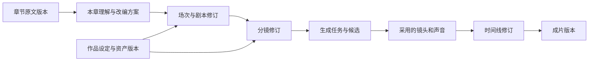
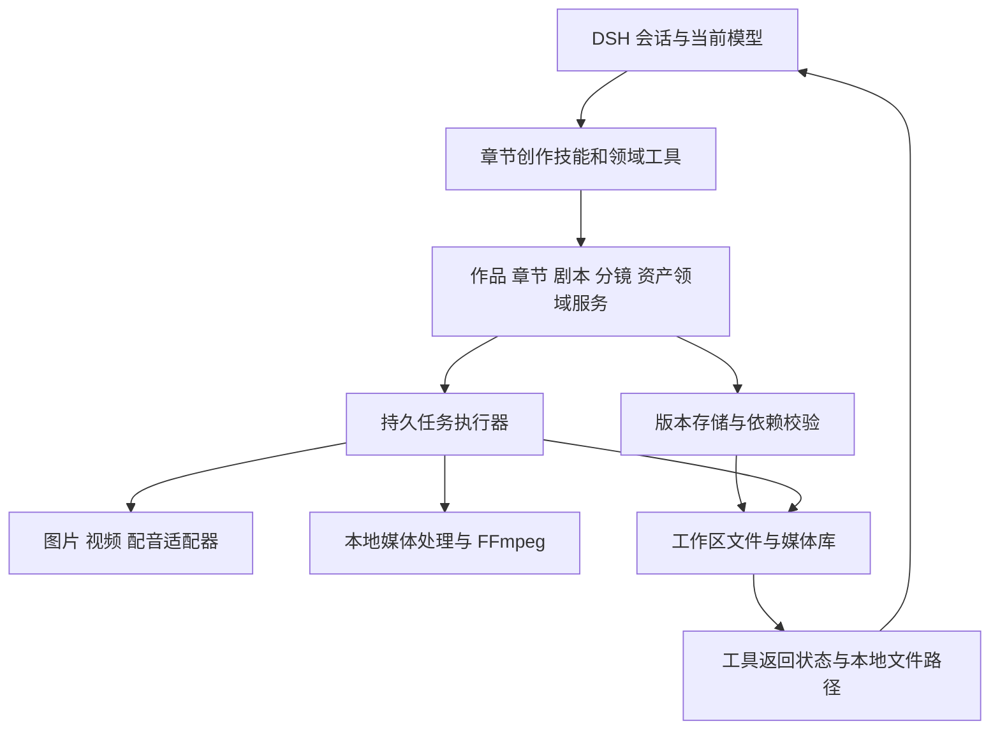

# DSH Video Studio 项目规划

本文规划一个运行在 DeepSeek Harness 内的章节视频创作插件。用户把一章小说正文贴入 DSH 会话，DeepSeek 结合已有作品设定，协助完成本章改编、场次、分镜、素材制作、视频生成和剪辑，并在用户反馈下逐步推进。插件保存创作成果与进度，让下一章能够延续前一章，也让每一镜都可以单独修改。

本文记录产品与技术方案、实施范围和验收标准。当前范围为 DSH 会话创作插件：Skills、Tools、创作持久化、媒体执行，以及 DSH 原生媒体服务设置面板；除实现记录明确标注的能力外，其余设计仍属于规划。

**范围修订：创作交互统一使用 DSH 现有聊天与标准工具结果，候选和成片通过工具返回本地文件路径。API Key、接口地址和模型使用 DSH 原生设置面板。** 章节面板、定制工具结果卡、自由画布、独立网页、HTTP 媒体接口和浏览器工作区 registry 已撤销。

| 项目 | 内容 |
| --- | --- |
| 文档版本 | 0.3，会话创作与原生服务设置 |
| 编写日期 | 2026-09-30 |
| 新项目目录 | `/Users/zhaoman/code/deepseek/projects/dsh-video-studio` |
| 当前状态 | 保留会话创作、持久化、供应商任务与 FFmpeg 链路，客户端仅提供服务设置；最新实测结果见 [IMPLEMENTATION.md](IMPLEMENTATION.md) |
| 参考项目 A | `dsh-directorx`，本地提交 `86f7cf9` |
| 参考项目 B | 外层原有 `dsh-video-studio`，下文称“鲸影”，本地提交 `36198b8` |
| 宿主核对基线 | 本地 `deepseek-harness`，提交 `4878cdabd8`，根包版本 `0.2.0-rc.1` |
| 本文边界 | 记录完整产品规划，不能作为所有功能已完成的证明；首版实现进展单独记录，两个参考项目保持不变 |

阅读建议：先看第 1–6 节确认创作方式；第 7–13 节描述数据与技术方案；第 14–16 节用于安排实施和验收。附录 A 提供本地源码依据。

## 1. 已确认的方向与待讨论的选择

### 1.1 已确认的方向

1. **建立独立新项目。** 外层两个项目提供参考，新项目拥有独立代码、标识和数据。
2. **创作只通过 DSH 会话使用。** 创作、查询、修改、候选采用和交付均由现有会话中的 Skills 与 Tools 完成；密钥和模型在 DSH 设置中填写。
3. **按章创作。** 用户可以直接复制一章小说到会话，不要求先上传整本书、导入小说库或确定总集数。
4. **逐步推进。** DeepSeek 先理解内容，再协助拆解和制作；用户可以随时讨论、修改、暂停和继续。
5. **目标覆盖小说到视频。** 文本、分镜、角色与场景素材、视频、配音、字幕和剪辑需要形成可衔接的创作过程。
6. **参考两个现有项目的具体实现。** 保留有价值的方法与模块，同时核对实际能力，避免把 README 描述当作已经打通的功能。
7. **先讨论，再实现。** 本文形成后，用户已授权开始实现；后续版本依此规划推进，阶段完成情况另行核对。

### 1.2 建议方案

以下是本规划提出的默认设计，仍可在讨论中调整。

| 事项 | 建议 | 理由 |
| --- | --- | --- |
| 作品与章节 | 一个作品管理多章原文及共享资产，每章有独立创作进度 | 适应长期连载和中断后继续 |
| 小说章与视频集 | 章是来源单位，视频集是交付单位；初期默认一章对应一个交付单元 | 保留一章拆多集、多章合一集的可能 |
| 第一轮反馈 | 先给本章理解、人物与场景增量、场次草案及少量关键问题 | 先让用户判断改编方向 |
| 自动推进范围 | 整理、校验和保存自动完成；重要创作取舍与生成范围按用户已表达的意愿推进 | 避免每次保存都询问，也避免越过创作决定 |
| 交互方式（已确定） | DSH 会话、标准工具结果、分镜表与本地文件路径 | 自然语言逐步创作，保持单一入口 |
| 原文处理 | 保存原文版本，改编稿单独记录；证据不足的设定标为待确认 | 保持来源清晰，减少跨章矛盾 |
| 素材策略 | 角色与场景先形成可复用设定，镜头引用明确版本 | 便于一致性检查和局部重做 |
| 第一版生成接入 | 选定一条可验证的图像通道、一条视频通道和一种配音方式 | 优先交付可复现的完整路径 |
| 初期持久化 | 类型化 JSON 文档、不可变版本文件与事务提交记录 | 可查看、可备份，适合单用户本地工作区 |

### 1.3 当前不设为前提的事项

总章数、总集数、整部作品结局、固定题材、固定画风、具体付费模型和外部云服务均不作为开始第一章创作的前提。单章目标时长可以先给范围，在剧本和配音阶段逐渐收敛。

## 2. 产品定位与核心体验

### 2.1 谁负责什么

**用户是创作决策者。** 用户提供正文、偏好和反馈，决定重要改编取舍，选择角色形象、镜头版本与交付结果。

**DeepSeek Harness 中的模型是创作协作者。** 模型阅读正文、理解语义、提出场次与分镜、组织工具调用，并根据反馈修订。它沿用 DSH 的会话、上下文、工具和执行机制。

**插件负责可靠执行和记忆。** 插件提供章节、设定、剧本、分镜、资产、生成任务和时间线的读写工具，进行结构校验，展示结果，保存版本，并调用媒体生成与合成能力。

模型负责创作判断，程序负责保存与核对。不能用按标点拆句替代分镜创作，也不能只靠聊天历史记住已确定的人物设定。

### 2.2 一次典型创作

```text
用户：这是《渡口》的第一章，帮我做成短剧，先看怎么拍。
      [粘贴正文]

DeepSeek：整理本章主要事件、出场人物、场景和改编难点。
          给出场次草案，指出一处需要取舍的内心独白。

用户：独白保留一部分旁白。渡口那场不要删。

DeepSeek：保存改编决定，形成逐场动作与台词，再按用户要求拆分镜。
          在当前会话中给出按场分组的分镜表，工具保存对应结构与修订。

用户：第三镜改成从背后拍，第五镜多停两秒。

DeepSeek：只修订相关镜头，检查对白时长及前后衔接。

用户：先做主角和渡口的设定图。

DeepSeek：使用配置好的图像通道生成候选，记录模型、提示词与参考版本。

用户：主角用第二张，场景用第一张。先生成前两镜。

DeepSeek：绑定选定资产，提交前两镜；查询任务并列出候选编号与本地文件路径，等待挑选或修改。

用户：这些镜头可以了，配音、加字幕，剪成这一集。

DeepSeek：组装时间线，检查文件、时长与音轨，返回视频、字幕与时间线的本地文件路径。

用户：这是第二章，继续。

DeepSeek：读取已确认设定及前章剧情状态，只新增本章需要的内容。
```

用户无需记住内部对象 ID、模型协议或工具参数。模型将自然语言转换为持久作品数据的工具操作，在会话中说明保存了什么、当前进度与下一步。

### 2.3 核心体验要求

- 用户随时知道当前作品、当前章、所在阶段以及下一步可做什么。
- 任何生成结果都能追溯到对应镜头、提示词版本和引用资产。
- 更改创作方向时，先展示影响范围，保留已有候选和旧版本。
- 关闭 DSH 后可以恢复创作成果和任务状态；远端仍在运行的任务继续查询。
- 用户只要求制作某场或某几个镜头时，范围内工作能够独立完成。
- 第一章无需等待后续原文；后续章节出现新事实时，允许修订原有理解并提示冲突。

## 3. 两个参考项目的结论与取舍

本节结论来自本地源码、技能流程和数据类型的只读核对。尚未对它们的全部功能做运行验证，也未调用真实生成服务。

### 3.1 DirectorX 的参考价值

| 已核对的实现或流程 | 对本项目的价值 | 调整要求 |
| --- | --- | --- |
| 文学改编流程区分大纲、角色、美术、剧本、分镜 | 形成逐层可审阅的创作成果 | 改为当前章优先，允许作品未完结 |
| 剧本使用场次、动作节拍和结构化台词 | 台词可用于配音，动作可用于镜头设计 | 保留对白、旁白和画外音的语义区分 |
| 分镜对应连续剧本节拍，并检查覆盖、顺序和台词时长 | 防止漏剧情、重复表现、对白塞不进镜头 | 保留通用校验，将 H3 等专属提示词约束移至模型适配层 |
| 系列包保存角色参考、服装、道具、视觉风格与镜头规则 | 支持跨章复用既定资产 | 增加章节剧情状态和版本，不把资产复用等同剧情记忆 |
| 原项目通过画布节点携带镜头上下文进入会话 | 只借鉴目标镜头、修订和邻接上下文的组织方式 | 画布与前端方案已撤销；由上下文工具直接读取指定镜头 |
| 局部修改规划读取角色、风格和邻接镜头 | 支持“只改这一镜” | 加入明确的依赖关系和影响标记 |
| 阶段与产物写入工作区文件 | 中断后能读取创作进度 | 从单份项目阶段扩展为章、场、镜头各自的状态 |

DirectorX 的整体方向最贴近本项目，但其小说大纲流程以整本书、总集数和单集时长为前提。新项目需要重新编写“当前章创作”的方法，不能要求用户先完成全剧大纲。

### 3.2 鲸影的参考价值

| 已核对的实现 | 对本项目的价值 | 已知边界 |
| --- | --- | --- |
| DSH 工具注册及其宿主契约 | 保留 Tools 接入方法 | 使用宿主标准工具结果；参考原生 Config / volatile 设置方法，客户端仅注册设置插槽 |
| 供应商接口包含能力、报价、提交、查询、取回和健康检查 | 媒体执行层可形成稳定接口 | 需要核对真实图像引用、参数限制和不同媒介的输出 |
| 账号池按账号绑定凭证，提交后记额度，失败后冷却 | 账号与任务关联、额度跟踪可参考 | 要区分安全重试与可能重复提交的情况 |
| 风格、镜头模板、人工内容等提示词分层 | 保留作品风格和逐镜编辑内容 | 质量词追加属于规则处理，不是语义创作或质量保证 |
| 资产主图与逐镜变体的数据结构 | 可作为资产版本设计的参考 | 当前是内存对象加导出，参考图注入主要为文字拼接 |
| 视频、音轨、字幕时间线及 FFmpeg 渲染 | 本章成片的基础模型 | 需验证真实素材、字幕排版、配音时长和重渲染行为 |
| 剪映草稿生成与结构检查 | 后续可编辑交付的参考 | 文件结构校验不能替代实际剪映版本中的导入验证 |

鲸影目前的分镜入口主要按标点切句，并限制条目数量；其流水线接收已经准备好的 `script.shots`。运行记录保存在内存 Map 中，保留数量有限。这些都需要在新项目中替换为语义创作与可持久化的作品模型。

### 3.3 复用方式

建议使用“模块评估后迁入”的方式，不将两个完整插件设为新项目的运行依赖，也不在运行时跨目录导入它们的内部源码。

| 类别 | 处理方式 |
| --- | --- |
| 创作方法、分层结构、会话协作方式 | 借鉴思路，编写章节专用技能与工具契约 |
| 纯函数、时间线、供应商适配器 | 核对依赖与契约后选择性迁入，保留来源，补必要验证 |
| DSH 接入代码 | 对照当前宿主接口实现，不把旧项目调用方式当作永久接口 |
| 工具、技能、插件 ID、配置与数据目录 | 为新项目使用独立命名，避免覆盖已安装参考插件 |
| 原项目界面、客户端与媒体路由 | 不迁入；对应建议已撤销 |
| 知识库和模型 | 按创作与媒体工具实际需要评估，首版不整体复制 |

源码迁入时记录来源项目、提交、文件和后续修改；保留相关许可证及来源说明。当前核对到 DirectorX 使用 Apache-2.0，鲸影使用 MIT；本项目最终发行方式与许可证尚未确定。

## 4. 章节创作流程

### 4.1 作品建立与章节接收

用户首次给出正文时，模型识别作品名和章节信息；如果无法可靠判断，只询问决定归属所必需的信息。已有活跃作品时可以沿用，并在会话回复及工具参数中明确归属。

插件保存原文、来源方式、接收时间、内容摘要和内容哈希。相同正文再次提交时，提示关联已有章节或创建修订，避免无意重复建章。原文顺序使用稳定章节 ID 与可调整序号，不以文件名或章节标题作为唯一身份。

超长章节可以分段阅读和处理，但必须记录实际覆盖的段落，明确尚未读取的部分。不得把截断后的内容当作整章已读完。

### 4.2 本章理解与连续性检查

输入是当前原文，以及与本章有关的既有设定、前章结束状态和未解线索。第一轮建议形成以下草案：

| 草案内容 | 用户看到的内容 |
| --- | --- |
| 本章剧情理解 | 主要事件、人物目标、冲突、情绪变化、开头与结尾 |
| 新增与复用实体 | 已有角色、首次出现角色、场景、道具及别名匹配 |
| 视觉化难点 | 内心独白、时间跳转、多人场面、特效、难以直接表现的信息 |
| 连续性问题 | 与前章冲突的服装、关系、地点、时间或人物所知信息 |
| 改编建议 | 建议保留、压缩、合并、转为旁白或改为动作的内容 |

这里的“新增人物”先是文本设定草案，不自动生成定妆图。模型推测、原文明示和用户补充必须可区分。

### 4.3 改编方案与场次草案

模型结合目标风格与时长，把正文整理为可拍摄场次。每场说明地点、时间、人物、戏剧目的、关键动作及结尾状态，并关联来源段落。

删减关键情节、合并人物、改变人物动机等重大改编，需要让用户看到取舍。用户已明确要求忠实改编时，模型沿用该约束；已授权直接给初稿时，可以先完成草案再供修改，不增加重复询问。

小说章与视频集不必一一对应。第一版默认以当前章创建交付单元；出现拆集或合集需求时，明确展示来源范围与顺序，不复制原文成多个互不关联的章节。

### 4.4 剧本与台词

每场按顺序保存动作和台词条目。台词包含说话人、正文、语气、对白/旁白/画外音类型；动作包含可观察行为、参与者与大致持续时间。

内心活动需要明确选择表现手段，例如旁白、表情、动作、回忆或保留为创作注释。模型不能把心理描写原样送入视频模型并假定画面已经表达出来。

时长先用可配置语速估算，配音完成后以实际音频时长校准。原文对白需要改写时，保留原句与改编句的对应关系。

### 4.5 分镜设计

分镜以已经形成的剧本为输入，模型负责镜头语言，工具负责保存和校验。每个分镜条目至少包含：

- 所属章、场次、镜头序号及覆盖的动作/台词条目。
- 本镜的叙事目的、可见主体、动作与环境。
- 景别、机位、构图、运镜、预计时长。
- 角色、服装、场景、道具和光照状态的引用。
- 本镜开始与结束状态，以及前后衔接要求。
- 首帧图提示词、运动描述、对白和声音需求。
- 当前修订、确认状态、生成候选与已采用版本。

分镜设计与供应商提交参数分开保存。镜头可以表达 12 秒连续动作；若当前模型不支持这一长度，应提出分段方案并保留语义对应关系，不能静默截短。

单章内可以先完成一场，再继续下一场；已经确定的镜头可以先制作，其他镜头继续讨论。

### 4.6 角色与场景资产

角色设定、场景设定和道具规格在理解与剧本阶段形成，具体图像在用户需要时生成。模型先复用已采用的资产，再提出缺失资产清单。

角色资产区分身份与外观变体：同一角色换装、受伤或年龄变化属于有适用范围的变体。场景区分结构锚点与昼夜、天气、光照状态。新的变体不自动覆盖过去章节所使用的版本。

先制作少量代表性资产，用户选定后再扩展到相关镜头。参考图必须通过供应商实际支持的图片输入字段传入；只把 URL 写进自然语言提示词不能算已接入参考图。

### 4.7 镜头视频与声音制作

用户可以指定“生成本场”“先做前两镜”“重做第三镜”等范围。插件在提交前确定目标镜头修订、参考图版本、模型与参数，并显示任务范围及已知费用信息。

每次生成形成独立候选。失败、取消、未选中或旧版本候选仍可追溯，不自动覆盖当前采用版本。真实任务与本地预演要有明确标签；无生成能力时可以交付分镜和提示词，不显示虚构的完成状态。

对白按角色绑定音色，旁白独立设置。第一版可选择外部配音文件或一种 TTS 通道；口型同步作为后续可选能力，根据模型及场景需求决定。

### 4.8 剪辑与交付

时间线引用明确采用的镜头和声音版本，管理排序、裁剪、停留时间、字幕及音量。字幕优先按逐句配音定位，没有可靠词级对齐时明确使用句级时间。

先做媒体完整性检查，再提供预览供用户判断内容、节奏和连续性。只调整片段顺序、字幕或音量时重新渲染，不自动重新生成镜头。

最小交付包含可播放 MP4、SRT 字幕、创作数据与素材引用清单；后续可增加剪映草稿。无配音或无字幕是用户选择时，交付清单应如实说明。

### 4.9 继续下一章

本章创作过程和交付结果分别保存。进入下一章时，读取相关角色与场景、前章结束状态、未解线索和当前有效的用户偏好。

下一章可以在上一章尚未成片时开始。前章未确定的事实继续保留“暂定”标识；后续章节不能把它们当作不可变事实。章节新增设定与用户修订经确认后进入作品共享资料，并记录从哪一章开始生效。

遇到回忆、倒叙和后文揭示的秘密时，分别记录“事情在故事里何时发生”与“读到哪一章才知道这件事”。恢复某章的创作上下文时按当前视角读取，避免把后章才揭示的信息提前写进前章台词。

## 5. 创作状态与修订机制

### 5.1 分开记录创作状态与执行状态

“剧本已确认”不代表“所有镜头已生成”；“任务完成”也不代表“用户采用了结果”。建议使用独立状态字段。

| 对象 | 建议状态 |
| --- | --- |
| 创作修订 | `draft`、`in_review`、`approved`、`superseded` |
| 依赖有效性 | `current`、`needs_review`、`blocked` |
| 本地任务 | `queued`、`submitting`、`submitted`、`running`、`downloading`、`validating`、`succeeded`、`failed`、`cancelled`、`unknown` |
| 执行意图 | `active`、`stop_requested`；与供应商实际状态分别保存 |
| 成片版本 | `draft`、`rendering`、`rendered`、`accepted`、`superseded` |

章节阶段是对当前工作的摘要，例如理解、剧本、分镜、资产、镜头制作、剪辑；允许不同场次处在不同阶段，不设置一个强迫所有镜头同步移动的全局进度百分比。



每条箭头代表可查询的依赖关系。用户修改上游后，插件按关系提示受影响对象。

### 5.2 修改的影响范围

| 改动 | 必须重新核对的内容 | 可以保留的内容 |
| --- | --- | --- |
| 只改一条字幕的错别字 | 字幕及包含它的渲染版本 | 原视频、配音和其他镜头 |
| 改一句台词的正文 | 该句配音、承载它的镜头时长、字幕、相关时间线；对口型视频可能需重做 | 无关场次与无关资产 |
| 改一镜景别或动作 | 该镜图像/视频候选和邻接镜头连续性 | 其他镜头及已确认角色身份 |
| 更换一章的角色服装 | 引用该服装版本的本章镜头 | 使用其他服装版本的镜头 |
| 修改共享角色身份设定 | 按引用关系列出受影响章节与资产 | 已交付旧版仍可回看，不直接覆盖 |
| 修改原文 | 关联的理解、剧本、分镜和连续性事实 | 未受影响段落及历史版本 |

影响标记不等于自动重做。模型说明变化，用户可以保留旧版作为创作选择，也可以只更新选定范围。

### 5.3 确认与授权

确认绑定具体对象、修订版本、操作范围和必要参数。用户在会话中明确的确认或批量授权应能被工具记录并在相同范围内复用。

普通保存、格式校验、查看状态和在授权范围内推进不重复询问。增加生成数量、扩大范围、更换会导致不同费用的通道，或修改已确认方案中的关键内容时，应让用户看清新的范围。

旧版本的确认不能自动授权新版本生成。用户撤销后停止尚未提交的任务；已经提交到供应商的任务按该供应商能力处理，并说明状态。

## 6. DSH 会话中的交互设计

### 6.1 会话是唯一创作入口

支持自然语言意图，例如“这是第二章”“继续上一场”“把第三镜改成近景”“沿用上一章的人设”“先做这两个镜头”“只重新剪辑”。用户不必记工具名，也不必切换视图。

模型按需读取作品、当前章、目标镜头、最近决定、未解决问题与有效资产。切换作品或章节时，先读取并更新当前会话绑定，再明确作品与章节归属。

### 6.2 会话反馈与工具结果

此前面板分区建议已撤销，原本的信息需求改为会话中的查询和创作反馈：

| 用户意图 | 会话中给出的结果 |
| --- | --- |
| “现在做到哪里了” | 当前作品、章节、已确定内容、制作状态与下一步 |
| “看看这一章怎么拍” | 原文理解、改编决定、场次与预计时长 |
| “列出这一场的分镜” | 按场分组的分镜表、镜头 ID、动作/台词、时长与来源 |
| “沿用上章人物” | 当前章可知的角色/场景设定、已采用参考及本章新增状态 |
| “第三镜有哪些候选” | 候选编号、制作模式、版本、采用状态与本地路径 |
| “制作任务怎么样了” | 本地与远端真实状态、失败原因及可恢复操作 |
| “把成片给我” | 已完成版本的 MP4、SRT、时间线本地绝对路径与可用状态 |

分镜和候选使用宿主既有消息与标准工具结果呈现，不注册定制工具卡。工具提供可核对的事实，模型负责把结果组织成用户能理解的回复。

### 6.3 保存、修改与交付原则

- 每次修改通过领域命令保存，携带基础修订号；冲突后重读并比较，不静默覆盖其他会话的改动。
- “改第三镜”先核对当前章与镜头 ID，只提交实际要求的字段并检查邻接衔接。
- 生成、采用、渲染的范围依照用户已表达的意图，结果、候选与旧版本各自保留。
- 进度来自持久任务查询，不维护第二套临时创作事实，不虚构完成率。
- 使用 DSH 原生会话、问题和执行授权机制；小说中的命令式语句作为内容处理。
- 文件交付使用工具返回的本地绝对路径与可用状态，由已有本地工具查看；不建立浏览器预览服务。
- 客户端仅提供媒体服务设置，使用宿主 ConfigForms 和 settings.plugins.tab；创作功能通过对话与工具扩展。

## 7. 领域数据模型

### 7.1 主要实体

| 实体 | 作用 | 核心字段建议 |
| --- | --- | --- |
| `Work` | 作品根对象 | ID、标题、风格、默认制作偏好、默认打开章节、schemaVersion |
| `Chapter` | 一章来源与创作单元 | ID、顺序、标题、原文修订、当前阶段、创作产物引用 |
| `SourceRevision` | 不可变原文版本 | 内容哈希、原文路径、段落 ID、来源、接收时间 |
| `AdaptationRevision` | 本章理解和改编取舍 | 来源范围、事件、保留/压缩/改写说明、用户决定 |
| `Character` | 共享角色身份 | 稳定 ID、名字、别名、身份、外观约束、声音设定 |
| `CharacterState` | 角色随剧情变化的状态 | 原著/改编归属、剧情时点、知晓章节、位置、关系、伤势、所知信息、来源证据 |
| `Location` / `Prop` | 场景与道具设定 | 稳定 ID、描述、结构特征、变体、来源 |
| `Scene` | 剧情场次 | 地点、时间、参与者、叙事目的、开始与结束状态 |
| `Beat` | 单个动作或台词 | 稳定 ID、顺序、类型、动作/台词正文、说话人、来源范围 |
| `ShotRevision` | 镜头设计修订 | beat 引用、镜头语言、时长、参考资产、提示词、连续性要求 |
| `AssetVersion` | 可复用媒体版本 | 实体 ID、媒介、变体、文件哈希、生成来源、采用状态 |
| `GenerationJob` | 本地与远端任务对应 | 目标修订、操作键、尝试记录、本地状态、远端状态、停止意图、供应商任务 ID、账号引用 |
| `Take` | 一次生成候选 | 镜头修订、任务、媒体文件、参数、评分/备注、采用记录 |
| `Episode` | 视频交付单元 | 有序章节范围和镜头引用、目标时长、时间线引用 |
| `TimelineRevision` | 可重渲染编辑版本 | 采用的 take、音频与字幕版本、入出点、音量、转场 |
| `Render` | 一次渲染结果 | 时间线修订、输出文件、媒体检查、预览与交付状态 |
| `Decision` | 用户的创作决定或操作范围 | 对象修订、范围、决定、会话消息关联、时间 |
| `ContinuityFact` | 跨章剧情事实或未解线索 | 原著/改编归属、主体、事实、剧情时点、知晓章节、有效范围、证据、暂定/确认状态 |

### 7.2 原文与创作成果的追溯

引用原文时使用 `sourceRevisionId + paragraphId + 文本范围`；正文变更产生新版本，并重新核对受影响引用。角色与镜头不能只依靠可变名字匹配。

同一事实标注来源类型：原文明示、用户补充、模型推断或改编新增。模型推断不自动写成已确认的作品设定。新增剧情应可被识别为改编选择。

原著事实与本作品采用的改编事实分别标识，例如 `continuityScope: source | adaptation`，并关联改编修订。用户决定合并角色或调整事件时，保留原著记录，同时更新改编对应关系；下一章应报告原著与改编的差异，不能把已经确认的改编一律判为错误。

事实还区分剧情发生时点与知晓范围。时点可以是相对场次或事件顺序，不强迫所有小说使用精确日期；知晓范围包含读者截至哪一章得知、角色在何时得知。回忆和秘密揭示应沿用这两种维度核对。

### 7.3 修订与并发

写入命令携带 `expectedRevision`。两个会话或后台任务与会话同时修改作品时返回冲突及最新修订。模型应重读受影响对象、比较差异，再提交用户要求的实际字段；不能拿旧对象整体覆盖新状态，也不能只替换版本号后盲目重试。

历史修订保留，当前采用版本由显式指针确定。资产选择改变时生成新采用记录，旧成片继续引用旧版本，确保可以重现。

### 7.4 章节与视频集的映射

`Chapter` 保留小说来源结构，`Episode` 保存交付结构。默认一个 Episode 引用一章的一组镜头，但数据上允许有序引用多个章的场次，也允许一章镜头分配给多个 Episode。

第一版只需提供默认一章一集的交互；拆集与合集可在后续通过会话工具扩展。初始模型必须避免把 `chapterId` 与 `episodeId` 合为同一个字段，否则后续很难扩展。

## 8. 技术架构与 DSH 接入

### 8.1 架构建议



插件中的任务执行器只处理已经确定的媒体任务、轮询和本地合成。创作决策、对话推进和多步工具使用仍由 DSH 模型完成，不建立第二套聊天服务或创作 agent loop。

### 8.2 模块职责

| 模块 | 职责 | 不应承担的职责 |
| --- | --- | --- |
| Host integration | 工具、技能、提示上下文、会话工作目录与生命周期注册 | 直接存放所有业务逻辑 |
| Domain | 作品、章节、修订、引用、采用记录与影响范围 | 调用具体供应商 HTTP 协议 |
| Authoring | 草案保存、结构校验、当前上下文读取 | 通过规则拆句冒充语义分镜 |
| Storage | 原子提交、版本读取、恢复和索引 | 将聊天摘要作为唯一事实来源 |
| Jobs | 队列、任务状态、远端 ID、恢复和重试 | 自行扩大生成范围或替用户选择创作版本 |
| Providers | 能力描述、参数转换、提交、查询、下载信息 | 决定小说情节或隐式替换模型 |
| Media | 探测、规范化、字幕、混音、合成与导出 | 在重新剪辑时隐式重新生成镜头 |
| Tool output | 结构化状态、分镜、候选及本地文件路径清单 | 伪造文件可用性或把已提交说成制作完成 |

### 8.3 工作区与会话绑定

建议保存 `SessionBinding { workspaceId, sessionId, workId, chapterId, episodeId? }`。工具从 DSH 执行上下文解析工作区和会话，再核对请求中的作品与章节归属。

当前选中章节由会话绑定持有；`Work` 的默认打开章节仅供新会话初始化，不作为所有会话共享的活动指针。两个会话分别编辑同一作品的第一章和第二章时，不应互相切换当前章。

本地 DSH 的工作区具有稳定 ID，工具执行上下文提供 agent 与取消信号；DirectorX 也有按调用上下文解析会话工作目录的实现。接入时应核对这些原生接口，不使用进程级“当前作品”变量处理所有请求。

所有工具操作都需要明确的工作区和作品归属。工作目录从当前 DSH 工具执行上下文取得，不维护额外的浏览器登记表。未知绑定返回可理解的错误，不能默默写到第一个工作区。会话切章只改变绑定，不移动或重建原有作品数据。

### 8.4 插件独立与共存

仓库目录为 `dsh-video-studio`。包名及运行时插件 ID 为 `dsh-chapter-video-studio`，工具使用 `video_studio_*` 前缀，技能统一为 `chapter-video-authoring` 与 `chapter-video-production`，与旧鲸影保持隔离。

以下标识必须统一隔离：包名、Cordis patch ID、工具名、技能名、系统提示片段名、供应商配置、任务及数据根目录。

新插件默认不读取、迁移或改写旧鲸影的凭证库。确需复用配置时提供明确的映射操作，记录目标环境。参考插件不需要在运行时安装；三者共存则属于集成验收场景。

### 8.5 技术选择建议

- 使用 TypeScript，仅构建 DSH 宿主插件；通过 Tools、Skills、SystemPrompt 和 Cordis 生命周期接入。
- 语义处理使用 DSH 当前会话模型；不要求用户再配置一个独立的小说理解 API。
- 工具读取当前宿主会话和工作目录，通过标准工具结果返回结构化内容及本地文件路径；无客户端构建或 React 依赖。
- 本地合成以 FFmpeg/FFprobe 为基础，启动前探测二进制、编解码器和字幕能力。
- 媒体适配器按能力接入；不依据品牌名推断某个模型支持参考图、首尾帧或音频。
- 初期采用单用户本地工作区存储；多人协作和分布式任务执行不进入首版范围。

## 9. 模型工具与创作技能

### 9.1 工具设计原则

工具应完成确定且边界清楚的操作。提交、查询、采用和重试分别表达，查询工具不产生新的生成费用；大对象按需读取，写入经过 schema 校验。

当前工具按以下职责组织，后续扩展继续使用同一会话入口。

| 工具 | 主要能力 | 关键约束 |
| --- | --- | --- |
| `video_studio_work` | 建立、列出和打开作品 | 明确当前会话工作区与作品归属 |
| `video_studio_chapter` | 保存一章原文或来源新版本 | 内容去重，保留来源 |
| `video_studio_context` | 读取当前章、相关设定、待办与进度 | 按需返回，不注入全书和全部历史 |
| `video_studio_draft` | 保存结构化草案或局部修改单镜 | schema 与 expectedRevision 校验，不顺带重生成 |
| `video_studio_canon` | 维护共享人物、场景、道具与风格 | 稳定 ID、设定版本与已知章节范围 |
| `video_studio_fact` | 保存原著/改编事实及证据 | 推测与确认分开，防止后章泄露 |
| `video_studio_validate` | 检查引用、覆盖、时长和资产要求 | 区分错误、提醒与未检查项 |
| `video_studio_decision` | 记录用户反馈和当前修订确认 | 不替用户虚构确认 |
| `video_studio_asset` | 归档用户提供的本地参考媒体 | 文件进入当前作品资产库并保留来源 |
| `video_studio_generate` | 在明确范围内创建媒体任务 | 操作幂等键、输入快照、预演/生产区分 |
| `video_studio_job` | 查询、取消、恢复任务，返回本地交付文件 | list 不提交新生成；files 提供绝对路径与可用状态 |
| `video_studio_take` | 采用用户指定的候选 | 保留其他候选，不采用失效结果 |
| `video_studio_render` | 从已采用镜头合成并检查输出 | 保留输入与渲染版本，不重新调用媒体模型 |

工具输出包含对象 ID、修订号、状态、变更摘要、待处理问题和实际可用的本地产物。交付使用 `video_studio_job` 的 `list` 操作返回的 `files` 清单，记录本地绝对 `path`、`available`、媒介/MIME 及对应资产或渲染 ID。文件缺失时必须如实说明，不能只凭旧状态声称已交付。

错误区分输入错误、修订冲突、缺少能力、缺少资产、凭证问题和远端错误，避免统一返回“生成失败”。

### 9.2 章节创作与制作技能

运行时技能统一为 `chapter-video-authoring` 和 `chapter-video-production`，分别对应同名技能目录。下表是两项技能内部的工作阶段，不要求每阶段单独安装技能。

| 技能 | 输入 | 输出 | 工作边界 |
| --- | --- | --- | --- |
| 章节接收与理解 | 本章原文、既有上下文 | 剧情理解、实体增量、待确认事项 | 只依据已知章节，不补写未知后文 |
| 章节改编与剧本 | 用户取舍、章节原文 | 场次、动作、台词、旁白 | 不直接发起媒体生成 |
| 分镜创作 | 剧本、视觉设定、时长范围 | 分镜条目、节拍对应、连续性要求 | 不在拆镜过程中擅自改掉已定台词 |
| 资产与视觉设定 | 角色/场景规格、风格 | 参考图计划与候选选择 | 先查现有资产，避免重复设计 |
| 镜头制作与修订 | 镜头修订、选定资产 | 提示词成稿、任务、候选与反馈 | 按指定镜头范围推进 |
| 本章剪辑与交付 | 已采用镜头、声音、交付要求 | 时间线、预览和输出清单 | 改剪辑不扩大生成范围 |
| 连续性与继续创作 | 章末状态、用户修订、新章节 | 可追溯的状态增量与恢复摘要 | 推测、确认和原文事实分开 |

技能负责指导模型如何组织工作；身份引用、节拍覆盖、任务幂等和文件有效性等要求通过程序检查，不能只写在提示词中。

## 10. 数据落盘与恢复

### 10.1 创作数据目录建议

以下路径位于用户的 DSH 创作工作区，区别于插件源码仓库。

```text
<workspace>/.dsh-video-studio/
  workspace.json
  bindings/
  works/<work-id>/
    work.json
    canon/
      characters/
      locations/
      props/
      style/
    continuity/
    chapters/<chapter-id>/
      chapter.json
      source/<revision-id>.txt
      source/<revision-id>.json
      adaptation/
      script/
      storyboard/
      decisions/
    assets/<asset-id>/<version-id>/
    jobs/<job-id>.json
    takes/<take-id>.json
    episodes/<episode-id>/
      episode.json
      timelines/
      renders/
    revisions/
    events/
    indexes/
```

目录与 schema 属于建议，可在实现阶段简化，但原文、修订、任务和媒体文件的职责必须分清。作品 ID 和章节 ID 使用程序生成的稳定值；标题仅作为显示信息。

### 10.2 写入一致性

单个对象采用临时文件写入后原子替换。跨对象变更先写不可变修订与事务清单，再提交一次可识别的事务记录，最后更新可重建索引；启动时能够识别未完成事务并恢复或回退。

每个作品的写入通过互斥队列串行提交，配合 `expectedRevision` 防止并发覆盖。进程间访问需要明确锁与超时，不能只依赖内存锁。实现阶段若无法合理保证这些性质，再评估以 SQLite 代替跨文件事务；不能将选择 JSON 理解为可以忽略一致性。

### 10.3 可恢复与可追溯

- 关键创作事实保存在版本对象中，聊天摘要和搜索索引可以重建。
- 每次写入记录关联会话、目标对象、基础修订和变更说明。
- `schemaVersion` 随持久化模型保存，升级前提供备份和迁移验证。
- 读取损坏文件时报告具体对象并保留原文件，不静默创建一个空作品覆盖它。
- 删除和清理使用显式操作；被成片或采用记录引用的素材不能自动清理。
- 工作区移动后优先通过 ID 和相对媒体路径恢复，避免所有素材绑定开发机绝对路径。

## 11. 生成任务与供应商执行

### 11.1 任务提交快照

每个媒体任务在网络提交之前保存以下信息：

| 信息 | 用途 |
| --- | --- |
| 本地 jobId、operationId 与 requestKey | 重复工具调用时识别同一操作，同时区分有意新建候选 |
| attemptId 与每次尝试的远端任务 ID | 保留重试历史，避免新尝试覆盖旧任务 |
| 作品、章节、镜头及精确修订 | 结果回到正确对象 |
| 提示词、参考图、声音及模型参数的版本与摘要 | 重现请求，识别变更 |
| 供应商、模型、账号引用、适配器版本 | 后续查询保持相同路由 |
| 生成范围及对应决定记录 | 核对是否仍在已确定的范围内 |
| 估价及是否未知、提交时间、远端任务 ID | 跟踪费用信息和恢复 |

API Key 使用 DSH 原生设置，保存在当前 profile 的 Cordis patch，读取时通过 secret role 脱敏；该配置文件不是加密凭证库。可显式切换为宿主环境变量，两种来源不混用。任务、会话、版本文档与工具结果不保存密钥，任务仅保留通道及配置指纹。

设置页分为方舟图片/视频和 OpenAI-compatible 配音，支持地址、模型、音色及参考图/时长能力。密码不回显，空输入保留已存值，清空通过明确操作；一次保存原子提交并校验配置版本。新请求读取更新后的配置，执行中的任务使用原配置，排队或恢复的旧任务必须匹配原指纹。设置保存与本地诊断不触发付费调用。

`requestKey` 的作用域包含作品、用户操作、目标修订及媒介类型。同一次操作因工具重复投递而再次调用时沿用该键；用户明确要求“同样参数再生成一版”时创建新的 operationId，不被内容哈希去重。每次允许重新提交的尝试有独立 attemptId；查询和下载重试继续使用原远端任务 ID。

### 11.2 状态转换与不确定提交

正常路径为 `queued → submitting → submitted → running → downloading → validating → succeeded`。远端任务完成只代表可以获取结果；本地下载和媒体校验完成后才算 succeeded，并允许该素材被采用。同步返回图片时可以跳过远端轮询，但仍需持久化、校验及登记。

任务从 queued 进入 submitting 时，在原子领取任务的同时重新检查目标修订、决定记录、范围和撤销状态；排队期间已经改稿或撤销的任务停止提交并说明原因。请求已发出后发生撤销，则按在途任务处理，不能声称此前从未提交。

遇到网络中断、超时或插件退出时，要区分以下情况：

| 场景 | 恢复行为 |
| --- | --- |
| 尚未提交 | 在原操作范围仍有效时继续排队 |
| 已保存远端任务 ID | 使用原账号继续查询，不创建新任务 |
| 远端已完成但下载失败 | 重试下载和校验，不重新生成；本地素材仍不可采用 |
| 远端是否接受无法确认 | 进入 `unknown`，优先用幂等键或任务查询核对 |
| 明确失败且可重试 | 按错误分类和上限重试，记录新的尝试 |
| 供应商无幂等或请求查询能力 | 无法保证不重复提交，必须展示不确定状态并进行显式处理 |

插件只能在供应商能力允许时保证提交幂等，不能宣称所有远端 API 都有“恰好一次”效果。

### 11.3 账号与能力路由

候选账号先按模型、媒介、参考图支持、时长、画幅和分辨率筛选，再考虑额度、健康与并发限制。费用单位需明确是金额、秒数、图片数还是内部配额。

真实费用无法获知时显示“未知/以供应商账单为准”，不能把旧适配器中的占位报价 0 当作免费。已获授权的批次可以继续执行，但超出明确范围不能静默扩大。

查询任务始终使用提交任务的账号。只有确认本次提交没有形成远端任务、且仍符合模型与范围约束时，才可按策略切换账号重试。原任务状态不明时不进行盲目切换。

### 11.4 取消、并发与生命周期

用户取消后立即停止未提交任务；远端支持取消则发出请求并记录结果，不支持时停止后续制作并继续准确标记远端状态，不能宣称供应商已取消。

分别保存执行意图、本地执行状态和 `remoteStatus`。例如工具结果及会话回复可以同时说明“已请求停止”和“供应商仍在运行”。取消与远端完成竞争时，已产生的结果可以登记为停止后返回的候选，但不自动采用、不启动后续生成或渲染；是否保留由用户后续决定。只有未提交即停止，或远端明确确认取消时，才将对应任务记为 cancelled。

图像、视频、下载和本地渲染使用独立并发限制，避免视频轮询占满渲染资源。重试采用有界退避；同一个任务只允许一个活跃执行者。

DSH 工具调用取消与项目任务取消需要明确语义：取消当前会话响应不应悄悄丢弃已提交媒体任务；工具返回持久 jobId，用户可以恢复查询。插件卸载时注销工具、监听与轮询，保存状态；重新加载后核对未完成任务。

### 11.5 文件与媒体处理边界

媒体下载检查响应、文件类型、大小和实际可解码性，使用临时文件完成后再登记。远端地址不能直接当作永久资产；已采用素材需要可持久访问的本地文件或受管理存储。

文件交付工具只返回当前作品已登记的媒体路径，并检查文件是否存在，不允许任意路径读取；FFmpeg 使用参数数组启动，不将小说文本、标题或提示词拼接为 shell 命令。日志过滤凭证与带签名的敏感 URL 参数。

## 12. 配音、字幕与成片设计

### 12.1 时间基准

剧本阶段保留预计时长，配音阶段记录实际时长，剪辑阶段使用统一整数时间单位。可以参考鲸影的微秒时间线，避免多轮浮点换算累积误差。

当台词实际时长超过镜头计划时，优先让用户看到可选方案：压缩台词、调整语速、延长停留或拆镜。不得静默裁掉句尾，也不得无条件把所有视频重复播放来填满时长。

### 12.2 声音来源

角色对白、旁白、环境声和音乐分别成轨。生成视频自带声音时，记录是否保留、静音或与后期配音混合，避免双重对白。

第一版建议先保证“逐句配音 + 对应字幕 + 镜头合成”。环境音、背景音乐自动选择、音量闪避和口型同步在基础版本验证后逐项扩展。

### 12.3 预览与导出

预览可以使用较低输出规格以缩短等待，但素材引用和剪辑决定必须与正式渲染一致。预览与正式输出清晰区分，不以低清预览冒充最终交付。

最终文件检查至少包括可解码性、视频与音频轨道、实际时长、画幅及字幕范围。MP4、SRT、时间线 JSON 和素材清单关联同一渲染版本，工具返回本地绝对路径与可用状态。字幕烧录或 MP4 软字幕轨的交付方式写入 `subtitleDelivery`，会话交付时按真实记录说明。

剪映草稿作为后续交付能力，需要注明验证过的软件版本、媒体路径策略和导入结果；未实测兼容前仅标记为实验性导出。

## 13. 质量校验与创作评审

### 13.1 程序校验

| 层级 | 检查内容 |
| --- | --- |
| 原文 | 内容完整、来源版本存在、引用范围有效 |
| 剧本 | 人物/场景引用存在，台词说话人合法，动作与台词类型清楚 |
| 分镜 | 剧本节拍覆盖、顺序与重复，场次归属，预计对白与镜头时长匹配 |
| 资产 | 所需参考文件存在、版本明确、供应商确实支持所需引用方式 |
| 提交 | 输入快照完整，范围与决定匹配，模型参数合法，无重复活跃任务 |
| 素材 | 下载成功、可解码、时长与分辨率符合实际用途 |
| 时间线 | 引用素材存在，入出点有效，字幕与音轨范围合理 |
| 成片 | 输出可播放、总时长合理、必要音轨存在、导出文件齐全 |

检查结果采用 `passed / failed / skipped / unknown` 四种状态。缺少上游剧本、参考图或检测能力时标记 skipped/unknown，不能视为通过。

### 13.2 模型评审与用户审片

模型可以结合可用的图像理解能力辅助评估人物外观、画面内容、动作、衔接和字幕可读性，但必须说明实际检查了哪些帧或媒体；未读取媒体不能仅凭文件名宣称画面合格。

剧情取舍、审美和表演效果保留用户评审入口。系统保存“为什么不采用”及修改建议，但不自动将一次偏好推广为整部作品的永久规则。

自动质检失败后首先定位问题；自动重做需处于明确授权的范围和次数内。单镜质量不佳不应触发整章重新生成。

## 14. 功能范围与实施顺序

### 14.1 第一阶段验证目标

先验证章节创作闭环：**贴第一章 → 保存原文 → 讨论改编 → 形成剧本和分镜 → 修改单镜 → 重启/换会话恢复 → 贴第二章复用设定。**

此阶段不以真实视频生成作为唯一成功标准，也不把本地占位片当作最终产品能力。它的目的在于确认创作方式与数据模型符合用户需要。

### 14.2 首个可用版本范围

首个端到端可用版本在上述闭环上增加：一条经验证的图像通道、一条视频通道、一种配音或外部音频方式、候选采用、可靠任务恢复、字幕与 MP4 合成。用户可在 DSH 内完成一章，并继续下一章。

| 范围 | 内容 |
| --- | --- |
| 首版必须 | DSH 原生 API Key/模型设置、会话接收章节、共享设定、结构化剧本/分镜、逐镜修改、版本与持久化、真实任务、局部重试、素材采用、配音字幕、成片与恢复 |
| 首版按需简化 | 固定顺序时间线、基本裁剪、基础音量控制、一种画幅、一组已验证模型组合 |
| 后续增强 | 多模型路由、完整多账号策略、时间线编辑工具、剪映草稿、口型同步、复杂音效、通过会话拆集合集 |
| 已撤销 | 创作工作台、章节面板、工具结果卡、自由画布、独立网页、HTTP 媒体接口与浏览器 registry |
| 暂不纳入 | 公开发布平台、多人实时协作、全书批量工厂、自动运营分发、训练生成模型 |

“首版按需简化”的具体选项仍由后续讨论确定；数据层需预留合理扩展点，技能和工具说明不把未实现能力当成现有功能。

### 14.3 里程碑与退出条件

| 阶段 | 主要交付 | 可检查的退出条件 |
| --- | --- | --- |
| M0 方案与契约 | 确定第一章交互、术语、schema 初稿、插件命名和依赖边界 | 用户能够用一章样例走读流程；实现范围与未决项明确 |
| M1 插件与存储基础 | 原生工具/技能接入、作品/章节/修订存储、上下文绑定 | DSH 可加载；三个插件共存无冲突；重启后原文与修订仍在 |
| M2 文本创作闭环 | 本章理解、剧本、分镜、修改影响、继续创作工具 | 通过第一章修改和第二章延续验收；无按标点冒充分镜 |
| M3 会话协作与本地交付 | 当前章上下文、分镜表、候选/任务查询、采用、本地文件路径 | 两个会话修改同一作品能检测冲突；自然语言可定位单镜；工具返回实际可用文件 |
| M4 资产与任务执行 | 资产版本、真实引用、一个图像/视频组合、持久任务与恢复 | 模拟故障测试通过；真实任务按范围返回并关联镜头；重启不盲目重提 |
| M5 本章成片 | 配音、字幕、时间线、预览、MP4 与交付清单 | 用一章素材出可播放成片；只改字幕后生成提交数不增加 |
| M6 稳定性与发布 | 迁移、诊断、恢复文档、构建包和宿主集成检查 | 新环境可按文档安装使用；卸载不破坏创作数据；真实能力矩阵与验证记录完整 |

M1 为 M2/M3 的基础；M4 的适配器研究可与 M3 并行，但任务契约必须先固定；M5 依赖可复用的媒体与时间线模型。每个阶段先交付可演示结果，再扩大能力范围，不以堆叠工具数量衡量进展。

### 14.4 建议的源码布局

```text
dsh-video-studio/
  docs/
    PROJECT-PLAN.md
  src/
    host/          # DSH 注册、生命周期与服务边界
    domain/        # 作品、章节、剧本、分镜、修订及依赖
    authoring/     # 上下文组装、草案命令、确定性校验
    storage/       # 版本存储、事务、索引、迁移
    jobs/          # 队列、执行、恢复、幂等及取消
    providers/     # 图像、视频、配音能力适配
    media/         # 探测、时间线、字幕、合成与导出
  skills/          # 章节创作方法
  test/            # 领域、任务故障、宿主与媒体集成验证
  scripts/         # 构建和开发验证
  cordis.patch.yml
  package.json
```

该布局仅为规划，不表示这些目录、工具或功能已经创建。

## 15. 验收场景与测试策略

### 15.1 必须覆盖的使用场景

| 编号 | 操作 | 预期结果 |
| --- | --- | --- |
| A01 | 直接在 DSH 粘贴第一章 | 建立来源记录，返回本章理解与下一步，不要求先导入全书 |
| A02 | 总章数和总集数未知 | 可以继续当前章剧本和分镜创作 |
| A03 | 用户说“第三镜改成背影” | 只新增第三镜修订，相关依赖标记准确，其他镜头内容不变 |
| A04 | 两个 DSH 会话同时修改同一镜头 | 产生修订冲突提示，重读比较后提交实际改动，无静默覆盖 |
| A05 | 关闭并重新打开 DSH | 原文、决定、已采用资产和章节进度可恢复 |
| A06 | 在新会话继续同一作品 | 从持久数据恢复上下文，不要求重贴全部设定 |
| A07 | 粘贴第二章并沿用人物 | 复用同一角色 ID 和参考版本，只补充本章变化 |
| A08 | 第二章人物受伤或换装 | 前章镜头仍使用原版本，不被后章状态污染 |
| A09 | 重复调用同一生成请求 | 本地任务去重；远端幂等能力与边界如实体现 |
| A10 | 提交后断网、重启 | 已知远端 ID 继续查询；未知提交状态不自动重新付费提交 |
| A11 | 远端完成但下载中断 | 重新下载现有结果，不重新生成；获取并校验成功前不显示为可采用素材 |
| A12 | 一个镜头失败 | 其他已完成镜头仍可采用，仅重试指定镜头 |
| A13 | 用户取消批次 | 未提交任务停止，已提交任务状态如实显示 |
| A14 | 使用角色或场景参考图 | 请求中的真实图片字段有对应文件/URL，而非只有文本链接 |
| A15 | 只改字幕、音量或排序 | 仅产生新时间线/成片版本，供应商生成调用数不增加 |
| A16 | 配音超过镜头时长 | 显示冲突并提供调整方式，不截断句尾冒充完成 |
| A17 | 同一工作区存在两个作品 | 会话、资产、任务和修改互不串数据 |
| A18 | 新插件与两个参考插件共存 | 工具、技能、系统提示、配置与数据目录互不冲突，客户端仅依赖宿主原生设置服务 |
| A19 | 无生成凭证或缺 FFmpeg | 文本创作可继续；媒体步骤说明缺少能力，不伪造成功 |
| A20 | 最终导出并在会话中取回交付结果 | 返回文件绝对路径与真实可用状态；文件可解码，必要轨道存在，字幕范围与实际时长一致 |
| A21 | 两个会话编辑同一作品的不同章 | 各自当前章不被对方切换，共享资产修改仍有修订冲突检查 |
| A22 | 后章揭示秘密，或改编有意改变原著事实 | 原著/改编分别可追溯，恢复前章时不会提前泄露后章信息 |
| A23 | 用户要求相同参数再生成一个候选 | 新建操作与候选；同一操作的重复投递仍被去重 |
| A24 | 取消恰逢提交或远端完成 | 停止意图与真实远端状态分别展示，迟到结果不自动采用或触发下游 |
| A25 | 任务已排队时改稿或撤销 | 提交前重新核对，旧版本或已撤销任务不发出新请求 |

### 15.2 分层验证

1. **领域测试：** 来源引用、角色状态生效范围、修订冲突、依赖传播和采用版本。
2. **任务契约测试：** 用模拟供应商验证接受后超时、查询失败、完成后下载失败、取消及重复调用。
3. **媒体集成测试：** 用短而真实的本地视频/图片/音频验证 FFmpeg、中文字幕、时长和重渲染。
4. **DSH 集成测试：** 验证工具 schema、技能/系统提示装载、会话上下文、本地路径交付、卸载清理与插件共存。
5. **真实供应商验证：** 在已配置通道和明确生成范围下做最小调用，保存模型、日期、输入和结果证据。
6. **人工创作走读：** 用至少两章有重复人物和状态变化的小说样例，验证“继续创作”体验。

模拟通过只证明任务逻辑和协议处理，不证明模型画面质量；媒体检查通过只证明文件可用，不代替用户对剧情和效果的验收。

## 16. 主要风险与待定事项

### 16.1 已识别的实现风险

| 风险 | 对策与验证方式 |
| --- | --- |
| 参考项目宣传与实际接线不一致 | 逐模块核对调用路径与测试；复用清单注明已验证、仅代码存在或待接入 |
| 章节增加后上下文膨胀 | 按角色、场次和章节读取相关事实，保留原文追溯，不每轮注入全书 |
| 上游修订导致大量素材看似失效 | 建立精确依赖，先提示影响，允许保留既有创作结果 |
| DSH 接口与打包方式变化 | 固定已验证宿主版本范围，隔离宿主适配层，做真实加载测试 |
| 不同模型参考图和时长能力差异 | 参数校验按具体模型，显示不支持项和替代方案，不静默降级 |
| 任务重试产生重复费用 | 保存提交意图与远端 ID，使用幂等能力，隔离不确定状态 |
| 外观复用仍出现生成漂移 | 保留资产版本，使用真实图片输入，先少量试镜并支持候选比较 |
| 配音与生成视频时长不一致 | 实际音频作为剪辑校准依据，在生成或合成前发现冲突 |
| 本地 JSON 跨文件修改不完整 | 事务清单、原子提交、锁与恢复测试；复杂度过高时调整存储方案 |
| 剪映格式随版本变化 | 固定验证版本并维护兼容记录，MP4/SRT 始终独立可交付 |

### 16.2 开始实现前优先讨论的事项

| 优先级 | 问题 | 本文建议 |
| --- | --- | --- |
| 首先确定 | 贴入一章后第一轮展示哪些成果 | 本章理解、人物/场景增量、场次草案，允许用户要求直接展开分镜 |
| 首先确定 | 默认在哪些创作节点停下来讨论 | 重大改编、视觉定稿、生成范围和成片采用；普通保存校验自动执行 |
| 首先确定 | 第一章的主要表现形式 | 选择一个真实样例讨论；叙事短剧、旁白漫剧等保持可配置 |
| 已确定 | DSH 交互承载 | 会话、Skills、Tools 与标准工具结果承载创作；DSH 设置承载密钥与模型配置 |
| 接入媒体前 | 实际使用的图像、视频、配音通道 | 依据用户现有配置选最小可验证组合 |
| 接入媒体前 | 默认画幅、目标时长与音频语言 | 作为作品偏好，可逐章覆盖 |
| 发布前 | 包名、插件运行时 ID、许可证和兼容版本 | 与旧项目隔离，记录来源与验证结果 |
| 后续讨论 | 是否需要拆集/合集与精细时间线工具 | 在第一章到成片的闭环验证后决定，通过会话操作 |

这些未决项不阻止阅读和讨论本规划；具体实现应按里程碑只解决当阶段必需的问题。

## 17. 下一步建议

以纯会话实现继续验收：使用一章样例走通正文保存、结构化分镜、局部修改、候选采用、合成和本地文件交付，再验证第二章延续。同时验证原生设置的保存、脱敏、热更新、版本冲突和重启恢复；测试数字与实际结果记录到 IMPLEMENTATION.md。

最先交付的代码应证明“章节能保存、DeepSeek 能通过工具写出和修改分镜、第二章能接上前章”，随后再接入真实媒体制作。只有完成一章真实成片并验证跨章继续，才能将新项目描述为端到端章节视频工作室。

## 附录 A 参考实现索引

以下链接指向本机参考仓库，行号对应本次核对时的源码。它们用于说明规划依据，不是新项目的运行依赖。参考仓库更新后需按提交重新核对。

| 来源 | 参考位置 | 支持的判断 |
| --- | --- | --- |
| DirectorX | [文学改编阶段](/Users/zhaoman/code/deepseek/dsh-directorx/src/compose.ts:103) | 大纲、角色、美术、剧本与分镜分层 |
| DirectorX | [原文接收与骨架讨论](/Users/zhaoman/code/deepseek/dsh-directorx/skills/novel-outline/SKILL.md:55) | 可以直接粘贴正文，先讨论改编骨架 |
| DirectorX | [整书与集数前提](/Users/zhaoman/code/deepseek/dsh-directorx/skills/novel-outline/SKILL.md:34) | 现有大纲流程需改造成章节优先 |
| DirectorX | [结构化剧本](/Users/zhaoman/code/deepseek/dsh-directorx/skills/novel-script/SKILL.md:36) | 动作与台词分开，剧本与分镜分别迭代 |
| DirectorX | [分镜与节拍对应](/Users/zhaoman/code/deepseek/dsh-directorx/skills/novel-storyboard/SKILL.md:40) | 分镜关联剧本、时长和素材 |
| DirectorX | [分镜检查实现](/Users/zhaoman/code/deepseek/dsh-directorx/skills/novel-storyboard/scripts/novel-storyboard.mjs:486) | 覆盖、台词、引用校验；缺输入时需改进状态表达 |
| DirectorX | [系列数据类型](/Users/zhaoman/code/deepseek/dsh-directorx/src/series.ts:34) | 共享角色、视觉和规则，尚非章节剧情账本 |
| DirectorX | [系列应用](/Users/zhaoman/code/deepseek/dsh-directorx/src/series.ts:277) | 角色参考与风格可以跨集复用 |
| DirectorX | [局部镜头修改](/Users/zhaoman/code/deepseek/dsh-directorx/src/revise.ts:48) | 带角色、风格和邻接上下文修改单镜 |
| DirectorX | [原生会话投递](/Users/zhaoman/code/deepseek/dsh-directorx/src/client/stage/SessionDock.tsx:176) | 历史参考：只保留镜头上下文的组织思路，对应前端方案已撤销 |
| DirectorX | [阶段保存](/Users/zhaoman/code/deepseek/dsh-directorx/src/stage.ts:74) | 阶段和产物落盘 |
| DirectorX | [保留宿主编排](/Users/zhaoman/code/deepseek/dsh-directorx/src/index.ts:149) | 使用 DSH agent loop 与原生扩展机制 |
| 鲸影 | [分镜拆句实现](/Users/zhaoman/code/deepseek/dsh-video-studio/src/host/storyboard.ts:26) | 当前按标点拆句，不能承担完整语义分镜 |
| 鲸影 | [流水线输入](/Users/zhaoman/code/deepseek/dsh-video-studio/src/director/pipeline.ts:94) | 接收已有 script.shots，再执行媒体流程 |
| 鲸影 | [供应商接口](/Users/zhaoman/code/deepseek/dsh-video-studio/src/provider.ts:49) | submit/status/fetch 与能力描述的参考 |
| 鲸影 | [按账号绑定供应商](/Users/zhaoman/code/deepseek/dsh-video-studio/src/quota/pooled-provider.ts:21) | 调度、计量与失败冷却的参考 |
| 鲸影 | [资产与参考注入](/Users/zhaoman/code/deepseek/dsh-video-studio/src/assets/library.ts:29) | 主图与变体；目前引用以提示词文本方式拼接 |
| 鲸影 | [风格记忆](/Users/zhaoman/code/deepseek/dsh-video-studio/src/memory/style-genome.ts:20) | 风格、模板、反馈，未包含完整章节剧情状态 |
| 鲸影 | [内存运行记录](/Users/zhaoman/code/deepseek/dsh-video-studio/src/host/runs.ts:22) | 需要新的持久任务存储 |
| 鲸影 | [时间线模型](/Users/zhaoman/code/deepseek/dsh-video-studio/src/finalcut/timeline.ts:8) | 视频、字幕、音轨及微秒时间单位 |
| 鲸影 | [FFmpeg 合成](/Users/zhaoman/code/deepseek/dsh-video-studio/src/finalcut/render-ffmpeg.ts:86) | 规范化、拼接、字幕与混音 |
| 鲸影 | [剪映草稿](/Users/zhaoman/code/deepseek/dsh-video-studio/src/finalcut/jianying-draft.ts:114) | 时间线导出和结构验证 |
| 鲸影 | [客户端注册](/Users/zhaoman/code/deepseek/dsh-video-studio/src/client/index.ts:509) | 历史参考：当前前端方案已撤销，不纳入产品与依赖 |
| DSH | [工具执行上下文](/Users/zhaoman/code/deepseek/deepseek-harness/packages/core/tools/src/index.ts:326) | agent 上下文与取消信号 |
| DSH | [工作区身份](/Users/zhaoman/code/deepseek/deepseek-harness/packages/workspace/workspace/src/types.ts:12) | 工作区身份与会话归属 |

## 附录 B 文档后的计划产物

以下文档在对应阶段需要时再建立，不在本轮提前生成空文件。

| 计划文档 | 用途 | 建议阶段 |
| --- | --- | --- |
| `USER-FLOW.md` | 一章实际走读、自然语言意图与工具结果示例 | M0 |
| `DATA-MODEL.md` | 类型、版本、状态和依赖规则 | M0–M1 |
| `DSH-INTEGRATION.md` | 宿主版本、Tools/Skills/SystemPrompt 接入与本地文件交付 | M1 |
| `PROVIDER-MATRIX.md` | 模型能力、已验证参数与真实测试日期 | M4 |
| `ACCEPTANCE.md` | 验收样例、结果和未通过项 | 各阶段更新 |
| `RECOVERY.md` | 任务不确定状态、数据恢复与迁移操作 | M4–M6 |
| `THIRD-PARTY.md` | 迁入源码、提交、许可证与修改记录 | 首次迁入代码时 |
